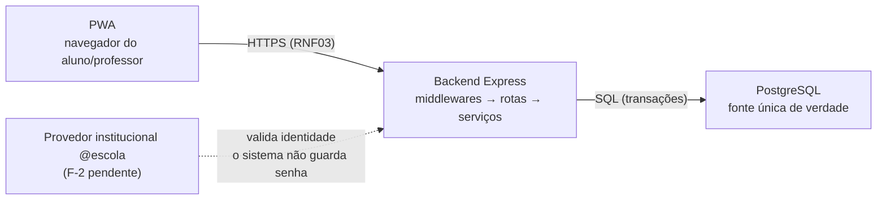
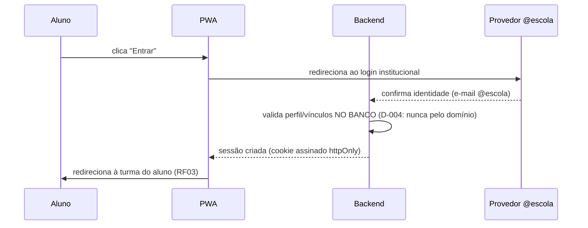

# Arquitetura Técnica — CEPK Eventos

Status: 🟢 versão 2.0 aprovada pelo autor em 2026-10-28 (proposta apresentada na sessão
e aprovada item a item). Descreve a arquitetura prevista; **nada de código foi
implementado** — a pasta `src/` ainda não existe.

Vinculada a: `requisitos.md` (v1.1), `decisoes.md` (D-001…D-011), `AGENTS.md`.

## 1. Visão geral em camadas



Explicação didática permanente (mantida da v1):

- **Frontend (PWA):** interface; **nunca** decide quem pode fazer o quê — o código do
  navegador é visível e manipulável pelo usuário (RNF02/RNF04).
- **Backend (Express):** o "gerente": valida quem chama, aplica regras
  (permissões, prazos, vagas) e só então responde.
- **PostgreSQL:** memória central e única fonte de verdade.
- **Provedor institucional:** autentica a conta `@escola`; nenhuma senha é armazenada
  pelo sistema (D-003; hospedagem do backend = pendência P-2).

## 2. Estrutura de pastas proposta

```text
cepk-eventos/
├── AGENTS.md                       ← regras permanentes (existe)
├── docs/                           ← existe (requisitos, arquitetura, decisões)
├── src/                            ← a criar só na etapa de código
│   ├── frontend/
│   │   ├── css/
│   │   │   └── main.css            ← estilos globais + responsividade (RNF01)
│   │   ├── js/
│   │   │   ├── api.js              ← ÚNICO ponto de chamadas HTTP ao backend
│   │   │   ├── offline.js          ← detecta conexão/avisa dados desatualizados (RF17)
│   │   │   └── ui.js               ← helpers de renderização (sem framework)
│   │   ├── pages/                  ← um HTML por tela
│   │   │   ├── index.html          ← calendário geral + turmas (RF01)
│   │   │   ├── login.html          ← botão → provedor institucional (RF02)
│   │   │   ├── turma.html          ← eventos da turma (RF03/RF04/RF16)
│   │   │   └── evento.html         ← detalhe + inscrição (RF15)
│   │   └── pwa/
│   │       ├── manifest.json       ← nome, ícones, cores → instalação (RF09/CA-06)
│   │       └── service-worker.js   ← cache somente-leitura p/ offline (RF17/CA-10)
│   └── backend/
│       ├── server.js               ← só liga o servidor (bootstrap)
│       ├── app.js                  ← roteamento + middlewares, SEM listen
│       ├── routes/                 ← declarações de endpoints (auth, events,
│       │                             classes, registrations)
│       ├── controllers/            ← traduz HTTP ↔ serviço; NÃO decide regras
│       ├── services/               ← regras de negócio: prazos, vagas,
│       │                             elegibilidade (RF07/RF14), cancelamento (RF11)
│       ├── middlewares/
│       │   ├── authenticate.js     ← valida sessão a cada request (RNF04)
│       │   ├── requireRole.js      ← exige papel (aluno/prof. autorizado/admin)
│       │   └── errorHandler.js     ← erro uniforme; nunca vaza detalhes do banco
│       ├── db/
│       │   ├── pool.js             ← conexões com PostgreSQL (RNF02)
│       │   ├── schema.sql          ← criação das tabelas (documento do BD)
│       │   └── queries/            ← SQL isolado por domínio (facilita auditoria)
│       └── config/
│           ├── env.js              ← lê e valida variáveis de ambiente (RNF05)
│           └── session.js          ← configuração de sessão (RNF09; valor pende F-17)
├── tests/
│   ├── unit/                       ← regras puras (prazo, vagas, elegibilidade)
│   ├── integration/                ← rotas + banco real de teste
│   └── e2e/                        ← roteiros MANUAIS (checklist PWA)
├── .env.example                    ← modelo SEM segredos (referência)
└── .gitignore                      ← já protege .env / node_modules
```

**Escolhas didáticas embutidas:**
- `api.js` como gargalo único: se uma URL mudar, muda em 1 arquivo.
- `middlewares/` centralizado: a regra 8 (permissões no backend) vira **código em um
  só lugar**, não algo que cada rota precise lembrar.

## 3. Responsabilidade de cada módulo

| Camada | Módulo | Responsabilidade | Não deve |
|---|---|---|---|
| Frontend | `pages/` | Telas e navegação | Conter lógica de permissão |
| Frontend | `js/api.js` | Chamadas HTTP + tratamento de estados (carregando/erro/offline) | Decidir funcionalidade só do lado cliente |
| Frontend | `pwa/` | Manifesto de instalação e service worker de cache (RF17) | Cachear dados privados de páginas autenticadas |
| Backend | `routes/` | Mapear URL → controller, declarando middlewares exigidos | Conter regras de negócio |
| Backend | `controllers/` | Ler a requisição, chamar serviço, montar a resposta HTTP | Acessar o banco diretamente |
| Backend | `services/` | Regras de negócio (prazos, vagas, elegibilidade, cancelamento) | Conhecer detalhes de HTTP |
| Backend | `middlewares/` | Autenticação e autorização em cada rota protegida | Não tem lógica de negócio |
| Backend | `db/` | Conexões, schema e SQL; transações de vagas | Retornar erros técnicos crus ao cliente |
| Backend | `config/` | Variáveis de ambiente e sessão | Ter segredos escritos no código |

## 4. Fluxos principais

### 4.1 Login (RF02/RF03; detalhe depende de F-2)



### 4.2 Consulta de eventos (RF04/RF05 — isolamento garantido no servidor)

1. PWA pede eventos (gerais ou da turma).
2. `authenticate` verifica sessão; serviço verifica vínculo no banco (RN01).
3. Backend responde **só** com o que o perfil permite — filtrar na tela
   **não confere** com CA-03 (tentativa por API direta também deve ser recusada).

### 4.3 Publicar/editar/cancelar evento (RF06; alcance de terceiros pende F-12)

1. `authenticate` + `requireRole('professor_autorizado'|'admin')`.
2. Serviço valida campos (prazo/vagas coerentes: RN02) e grava com registro de
   auditoria (RNF12).
3. Cada pedido revalida o papel — nunca confia no que a tela diz.

### 4.4 Inscrição (RF07/RF08/RF14/RNF07/RN08 — trecho mais sensível)

```mermaid
sequenceDiagram
  participant U as Aluno
  participant S as Backend
  participant D as PostgreSQL
  U->>S: POST inscrição (evento E)
  S->>S: middleware autentica sessão; offline => PWA nem envia (RF17)
  S->>D: transação: valida vínculo (RF14), prazo (RNF11), vagas (com bloqueio p/ concorrência)
  alt tudo válido e vaga disponível
    S->>D: grava inscrição e decrementa vagas (MESMA transação)
    S-->>U: 201 "inscrição confirmada"
  else qualquer regra falha
    S-->>U: erro claro (fora do prazo / lotado / sem vínculo / duplicada)
  end
  Note over U,S: a UI só exibe "confirmada" DEPOIS da resposta do servidor (RF08)
```

Detalhe importante (didático): a validação de vagas e a gravação acontecem **juntas**,
dentro de uma transação SQL — assim duas pessoas se inscrevendo "ao mesmo tempo" não
ultrapassam o limite (RA-06).

### 4.5 Offline (D-008/RF17/RN08)

- Service worker permite ler o calendário em cache **somente leitura**, com aviso de
  desatualização.
- Tentativa de inscrição sem conexão é bloqueada na interface ("requer conexão") —
  **nada é enfileirado** para envio posterior.
- Dados privados/páginas autenticadas não são cacheados.

## 5. Modelo de dados (esboço nível requisitos)

Entidades previstas (nomes/tipos exatos só no plano de desenvolvimento):

| Entidade | Papel | Regras associadas |
|---|---|---|
| `usuarios` | identidade do e-mail institucional + dados mínimos (RNF10) | D-003/D-004 |
| `turmas` | lista de turmas do CEPK | F-6 |
| `vinculos_aluno_turma` | relação aluno ↔ turma | RN01; manutenção = F-08 |
| `autorizacoes` | professor autorizado / administrador | RN04; origem = F-7/F-13 |
| `eventos` | título, descrição, datahora, local, escopo (geral ou turma), exige inscrição?, prazo, vagas | RF01/RF07/RF14 |
| `inscricoes` | uma por aluno por evento | RN07; cancelamento = F-5 |
| `registro_auditoria` | quem/ quando publicou, editou, cancelou, inscreveu | RNF12 |

### 5A. Perfis de acesso e permissões (D-023 — proposta aguardando banco e login real)

Pedido do autor (28/10/2026, itens 5 e 6): a página **Turmas** deve apresentar
conteúdo diferente por perfil. Isso exige back-end: sem banco (etapa 2) e sem login
real (etapa 4) NÃO há como diferenciar de verdade — nada disto pode ser maquete
fictícia ("não invente vínculos nem usuários administrativos fictícios").

**Vínculos necessários no banco (extensão do esboço acima):**

| Estrutura proposta | Para quê |
|---|---|
| `vinculos_aluno_turma` (existe) | aluno vê/só a própria turma — RN01, isolamento no servidor |
| `vinculos_professor_turma` (nova) | professor vê/administra APENAS as turmas em que é docente registrado |
| `vinculos_pedagogo_turmas` (nova) | pedagogo enxerga o CONJUNTO de turmas sob sua responsabilidade (definido por registro no banco — nunca pelo e-mail) |
| `direcao_escolar` (nova) | direção com permissão atribuída vê TODAS as turmas |
| `papeis` por vínculo | `aluno` · `professor` · `pedagogo` · `direcao` — a sessão carrega papéis/vínculos carregados do banco no login |

**Matriz de permissões (validadas NO BACKEND, endpoint por endpoint):**

| Perfil | Consultar turmas | Publicar/editar/cancelar evento | Inscrições |
|---|---|---|---|
| Aluno | só a própria | — | participar/cancelar a própria |
| Professor | as turmas de docência | nas turmas de docência (F-11: se autorizado) | ver listas da sua turma |
| Pedagogo | o conjunto sob sua responsabilidade | conforme permissão atribuída | conforme permissão |
| Direção | todas do colégio | conforme permissão (F-12: alcance de terceiros) | conforme permissão |

**Na interface (depois que a sessão real existir):** a página Turmas recebe do
servidor o próprio conjunto de turmas do usuário — o frontend só RENDERIZA o que
o backend autorizou (nunca decide por conta própria). Ação administrativa aparece
apenas para quem tem permissão real.

## 6. Configuração dos ambientes

| Ambiente | Onde roda | Banco | Segredos |
|---|---|---|---|
| Desenvolvimento | computador do autor (Node + PostgreSQL por **instalação direta** — D-010) | local, dados 100% fictícios (RNF10) | arquivo `.env` local, fora do Git, guiado por `.env.example` |
| Testes | mesma máquina; banco separado (`*_test`) | banco de teste com dados fictícios | `.env` de teste distinto |
| Publicação | hospedagem com HTTPS (P-2, a definir) | banco do servidor | segredos no painel da hospedagem — nunca no código |

Variáveis de ambiente previstas (à espera das dependências):

| Variável | Para quê | Depende de |
|---|---|---|
| `DATABASE_URL` | string de conexão com o PostgreSQL | nada — disponível já |
| `SESSION_SECRET` | assinar o cookie de sessão | gerado localmente; NUNCA no Git |
| `BASE_URL` | endereço público do backend | P-2 |
| credenciais do provedor | OAuth/institucional (a definir com F-2) | F-2 |
| `NODE_ENV` | dev/teste/produção | nada |

> Regra permanente (RNF05/regra 6): nenhum arquivo `.env` real entra no Git.
> O `.env.example` lista nomes de variáveis sem valores reais.

## 7. Estratégia de testes (ligada aos CAs da v1.1)

| Tipo | O que testa | Cobertura de critérios |
|---|---|---|
| Unitários (automatizados) | regras puras: prazos (RNF11), vagas, elegibilidade (RF14), duplicidade (RN07) | RN06/RN07 |
| Integração (automatizados) | rotas + banco de teste real; espelha as APIs | CA-03, CA-04, CA-05 |
| Segurança (automatizados) | URLs diretas de outra turma; aluno tentando publicar; inscrição duplicada; recursos pós-logout | CA-03, CA-04, CA-09, CA-10 |
| E2E manuais (roteiro) | instalação, responsividade, offline, fluxo completo do aluno | CA-01, CA-06, CA-07, CA-10 |

Condições permanentes: dados de teste **sempre fictícios** (RNF10); banco de teste
recriável a partir de `schema.sql`; nenhum teste menciona alunos/turmas reais.

> Ferramentas de automação (ex.: executor de testes) serão definidas no plano de
> desenvolvimento — nada é instalado nesta etapa (instrução do autor).

## 8. Escolhas técnicas aprovadas

| # | Escolha | Alternativa descartada | Por quê |
|---|---|---|---|
| 1 | Sessão via **cookie assinado `httpOnly`** | JWT no localStorage | `httpOnly` impede leitura do token por JavaScript; logout real (importante para computadores compartilhados na escola — AUD-06). **Aprovada pelo autor (2026-10-28); `decisoes.md` D-010** |
| 2 | Frontend sem framework (HTML/CSS/JS puros) | React/Vue | Coerente com D-002 e simplicidade; a PWA exige `manifest` + `service worker`, atendidos |
| 3 | SQL puro em `db/queries/` | ORM | SQL legível/didático e controle fino nas transações de vagas |
| 4 | Cache offline somente leitura (D-008) | Revalidação automática | Simples e coerente com RNF07/RN08 |
| 5 | PostgreSQL local por **instalação direta** | Docker Desktop | Escolha do autor para o ambiente de desenvolvimento (**decisoes.md D-011**) |

## 9. Decisões/pendências que condicionam o código

| Tema | Situação |
|---|---|
| Provedor institucional (F-2) | Define o módulo `auth` — nada de autenticação é codificado antes |
| Hospedagem com HTTPS (P-2) | Só afeta publicação; o desenvolvimento local não depende dela |
| Primeiro administrador (F-13) | Sugestão: script único de preparação do banco, executado manualmente pelo autor — detalhe no plano de desenvolvimento |
| Valor da expiração de sessão (F-17) | Parâmetro configurável em `config/session.js` |
| Ferramentas de testes/automatização | Definir no plano de desenvolvimento antes de instalar qualquer dependência |

## 10. Histórico de versões

| Versão | Data | Descrição |
|---|---|---|
| 1.0 | 2026-10-28 | Proposta inicial em texto (visão em camadas didática + organização de pastas genérica + fluxos em texto) |
| 2.0 | 2026-10-28 | Aprovada pelo autor: estrutura de pastas detalhada com responsabilidade por módulo, diagramas Mermaid (visão geral, login, inscrição transacional), esboço de entidades do banco, configuração de ambientes, estratégia de testes por camada e escolhas técnicas (D-010 sessão por cookie assinado; D-011 PostgreSQL por instalação direta) |
