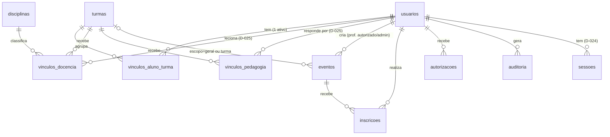

# Modelo de Dados — CEPK Eventos (PostgreSQL)

Status: 🟢 **v1.1 — primeira versão IMPLEMENTADA** (etapas 2–5 do plano: `src/backend/db/schema.sql`
aplicado no PostgreSQL local e testado pela suíte). As tabelas ainda sem código de uso
(`inscricoes`, `autorizacoes`, `auditoria`) continuam **propostas** até suas etapas.
Adições da v1.1 estão marcadas com **(D-024/D-025)**. Baseia-se nos requisitos v1.1 e na arquitetura v2.0.

## 1. Princípios do desenho

1. **PostgreSQL como única fonte de verdade** (RNF02): nenhuma decisão de permissão
   vive fora do banco (D-004).
2. **Coleta mínima de dados** (RNF10/AUD-17): o banco guarda apenas o que a operação
   exige — e-mail institucional, nome, vínculo funcional. Sem dados sensíveis.
3. **Datas/horários sempre em `TIMESTAMPTZ`** (deslocamento de fuso embutido);
   a API responde no FUSO DA ESCOLA (offset `-03:00`, D-025).
4. **Integridade no banco, sempre**: chaves estrangeiras, `CHECK`, `UNIQUE` — e as
   regras de negócio **também** novamente no backend (defesa em profundidade).
5. Contador de vagas **transacional** (colunas dedicadas) para suportar concorrência
   (RA-06); o universo de valores é restringido por `CHECK`.

## 2. Diagrama de entidades (visão geral)



## 3. Tabelas propostas (detalhamento)

### 3.1 `usuarios` — identidade (RF02)

| Campo | Tipo | Regra | Nota |
|---|---|---|---|
| id | `BIGSERIAL` (PK) | — | escolha de IDs em §6 |
| email | `TEXT` | `UNIQUE NOT NULL` | v1.1: `TEXT` (não `CITEXT`); o backend normaliza com `lower()` na consulta |
| nome | `TEXT` | `NOT NULL` | mínimo necessário (RNF10) |
| **papel** | `TEXT` | `NOT NULL CHECK (IN ('aluno','professor','pedagogia','direcao'))` | **(D-025)** define o ESCOPO de consulta (§ do arquivo `services/turmas-permissao.js`); autorização de publicação (RF06) continua na `autorizacoes` |
| **senha_hash** | `TEXT NULL` | — | **(D-024)** hash bcrypt de contas LOCAIS de demonstração; `NULL` = conta que entra somente pelo provedor institucional (F-2, futuro). JAMAIS guardar a senha em texto: só o hash |
| provedor | `TEXT NULL` | | 🔴 **Pendente F-2** (colunas do provedor exato definidas depois; não presumir) |
| provedor_sub | `TEXT NULL` | `UNIQUE` quando preenchido | 🔴 Pendente F-2 |
| ativo | `BOOLEAN NOT NULL DEFAULT true` | | desativa sem apagar (retenção: F-14) |
| criado_em / atualizado_em | `TIMESTAMPTZ` | `DEFAULT now()` | |

> ⚠️ A senha só existe como HASH (D-024), e apenas para as contas de demonstração.
> A senha inicial de demonstração é definida no `.env` local (fora do Git) e JAMAIS
> aparece em código, interface, documentos ou histórico. Nenhum campo sensível além disto (RNF10).

### 3.2 `turmas` — cadastro de turmas (RF01/RF13)

| Campo | Tipo | Regra | Nota |
|---|---|---|---|
| id | `BIGSERIAL` (PK) | | |
| nome_curto | `TEXT` | `UNIQUE NOT NULL` | dados reais do CEPK: 🔴 Pendente F-6 (hoje: 10 turmas de demonstração) |
| **tipo** | `TEXT` | `NOT NULL DEFAULT 'regular' CHECK (IN ('regular','tecnica'))` | **(D-025)** para o rótulo da interface ("curso técnico") |
| ano_letivo | `SMALLINT` | `NOT NULL` | |
| ativa | `BOOLEAN` | `NOT NULL DEFAULT true` | |
| criada_em | `TIMESTAMPTZ` | `NOT NULL DEFAULT now()` | |

### 3.3 `vinculos_aluno_turma` — vínculo aluno ↔ turma (RN01; D-009)

| Campo | Tipo | Regra | Nota |
|---|---|---|---|
| id | `BIGSERIAL` (PK) | | |
| usuario_id | `BIGINT` FK → `usuarios(id)` | `NOT NULL` | |
| turma_id | `BIGINT` FK → `turmas(id)` | `NOT NULL` | |
| ativo | `BOOLEAN` | `NOT NULL DEFAULT true` | transferência de turma: desativa o antigo (F-8: do quem fica a responsabilidade) |
| criado_em | `TIMESTAMPTZ` | `DEFAULT now()` | |

- **Restrição-chave:** índice parcial `UNIQUE (usuario_id) WHERE ativo = true` —
  cada aluno tem no máximo **um** vínculo ativo por vez (evita colisões de perfil).
- Quem cria/mantém registros aqui: 🔴 Pendente F-8 (endpoint de admin fica em `api.md`).

### 3.3a `disciplinas` — catálogo de disciplinas (D-025)

| Campo | Tipo | Regra | Nota |
|---|---|---|---|
| id | `BIGSERIAL` (PK) | | |
| nome | `TEXT` | `NOT NULL UNIQUE` | ex.: "Geografia" (seed de demonstração) |

### 3.3b `vinculos_docencia` — professor ↔ turma ↔ disciplina (D-025)

| Campo | Tipo | Regra | Nota |
|---|---|---|---|
| usuario_id | `BIGINT` FK → `usuarios(id)` | `NOT NULL` | |
| turma_id | `BIGINT` FK → `turmas(id)` | `NOT NULL` | |
| disciplina_id | `BIGINT` FK → `disciplinas(id)` | `NOT NULL` | |
| ativo | `BOOLEAN` | `NOT NULL DEFAULT true` | revogação = desativar |
| criado_em | `TIMESTAMPTZ` | `DEFAULT now()` | |

- Índice `UNIQUE (usuario_id, turma_id, disciplina_id) WHERE ativo = true`.
- O professor vê/só administra as turmas destas linhas; o próprio professor NÃO
  cria os seus vínculos (regra 7/8 do AGENTS; manutenção = F-8).
- `ON DELETE CASCADE` (vínculos são estruturais; usuário/turma excluído não deixa órfão).

### 3.3c `vinculos_pedagogia` — pedagogia ↳ conjunto de turmas (D-025)

| Campo | Tipo | Regra | Nota |
|---|---|---|---|
| usuario_id | `BIGINT` FK → `usuarios(id)` | `NOT NULL` | PRIMARY KEY (usuario_id, turma_id) |
| turma_id | `BIGINT` FK → `turmas(id)` | `NOT NULL` | |
| ativo | `BOOLEAN` | `NOT NULL DEFAULT true` | |
| criado_em | `TIMESTAMPTZ` | `DEFAULT now()` | |

- O conjunto de turmas sob responsabilidade é definido por LINHAS aqui —
  configurável no banco sem tocar código; nunca pelo e-mail (D-004).

### 3.3d `sessoes` — sessões de login (D-024)

| Tema | Detalhe |
|---|---|
| Gestão criada automaticamente pela biblioteca `connect-pg-simple` (colunas: sid, sess, expire) — não está em `schema.sql` |
| Guarda SÓ o identificador da sessão + mínimo de identidade (id, nome, e-mail, papel — JAMAIS senha) |
| Expiração: `SESSION_MAX_MINUTOS` (`.env`, altura em minutos; demo: 480 min / 8 h) |


### 3.4 `eventos` — gerais e por turma (RF01/RF04–RF07)

| Campo | Tipo | Regra | Nota |
|---|---|---|---|
| id | `BIGSERIAL` (PK) | | |
| titulo | `TEXT` | `NOT NULL` | |
| descricao | `TEXT` | | |
| local | `TEXT NULL` | | RF15 |
| inicio / fim | `TIMESTAMPTZ` | `NOT NULL; CHECK (fim > inicio)` | API responde com offset `-03:00` (D-025) |
| **tipo** | `TEXT` | `NOT NULL DEFAULT 'outro' CHECK (IN ('prova','feira','viagem','trabalho','boletim','outro'))` | **(D-025)** escolhe o estilo do cartão na grade (prova tem estilo próprio; os demais usam o de atividade) |
| escopo | `TEXT CHECK (escopo IN ('geral','turma'))` | `NOT NULL` | RF05/RF14 |
| turma_id | `BIGINT NULL` FK → `turmas(id) `| | exige-se `NOT NULL` quando `escopo='turma'` (ver CHECK abaixo) |
| exige_inscricao | `BOOLEAN NOT NULL DEFAULT false` | | RF07 |
| vagas_total | `SMALLINT NULL CHECK (vagas_total > 0)` | | requerido quando `exige_inscricao` |
| vagas_restantes | `SMALLINT NULL CHECK (vagas_restantes >= 0 AND vagas_restantes <= vagas_total)` | | idem; base da transação (§4.2) |
| prazo_inscricao | `TIMESTAMPTZ NULL` | | requerido quando `exige_inscricao`; política do F-11 |
| status | `TEXT CHECK (IN ('ativo','cancelado'))` | `NOT NULL DEFAULT 'ativo'` | sem cancelamento físico; 🔴 semântica pós-download: F-3 |
| criado_por | `BIGINT NULL` FK → `usuarios(id)` | | v1.1: implementado SEM `NOT NULL` (eventos de demonstração do seed não têm autor — quando a publicação existir, etapa 6, avaliar restabelecer `NOT NULL` RNF12) |
| criado_em / atualizado_em | `TIMESTAMPTZ` | `DEFAULT now()` | |

**CHECKs de coerência (propostas):**

```sql
CHECK (
  (escopo = 'geral'  AND turma_id IS NULL) OR
  (escopo = 'turma'  AND turma_id IS NOT NULL)
),
CHECK (
  NOT exige_inscricao OR (
    vagas_total IS NOT NULL AND vagas_restantes IS NOT NULL
    AND prazo_inscricao IS NOT NULL
  )
)
```

> Cadastro pelo aluno fica **proibido por formato** (FX-05): escrita em `eventos`
> só através de rotas de professores autorizados/admin.

### 3.5 `inscricoes` — inscrições (RF07/RF08/RF14)

| Campo | Tipo | Regra | Nota |
|---|---|---|---|
| id | `BIGSERIAL` (PK) | | |
| evento_id | `BIGINT` FK → `eventos(id)` | `NOT NULL` | |
| usuario_id | `BIGINT` FK → `usuarios(id)` | `NOT NULL` | |
| estado | `TEXT CHECK (IN ('confirmada','cancelada'))` | `NOT NULL DEFAULT 'confirmada'` | 'cancelada' só ganha sentido se F-5 for aprovado |
| criado_em | `TIMESTAMPTZ` | `DEFAULT now()` | hora da confirmação É o critério do CA-05 |

- **UNIQUE (evento_id, usuario_id)** → proíbe duplicata (RN07) no próprio banco.
- FK `ON DELETE RESTRICT`: inscrições não evaporam se evento for manipulado
  (independe da decisão F-3/F-5).

### 3.6 `autorizacoes` — professor autorizado / administrador (RF06; regra 7)

| Campo | Tipo | Regra | Nota |
|---|---|---|---|
| id | `BIGSERIAL` (PK) | | |
| usuario_id | `BIGINT` FK → `usuarios(id)` | `NOT NULL` | |
| papel | `TEXT CHECK (IN ('professor_autorizado','admin'))` | `NOT NULL` | |
| ativo | `BOOLEAN` | `NOT NULL DEFAULT true` | revogação é desativar (histórico preservado) |
| concedido_por | `BIGINT NULL` FK → `usuarios(id)` | | futuramente: logs de quem deu a autorização |
| desde | `TIMESTAMPTZ` | `DEFAULT now()` | |

- Índice parcial: `UNIQUE (usuario_id, papel) WHERE ativo = true`.
- **Nenhum papel derivável do e-mail**: regra 7 de AGENTS/D-004.
- Primeiro admin: 🔴 Pendente F-13 (script de preparação): este modelo permite
  sem aproximação paradoxal (nada é implícito).

### 3.7 `auditoria` — registro de auditoria (RNF12 — recomendação em aprovação)

| Campo | Tipo | Nota |
|---|---|---|
| id | `BIGSERIAL` (PK) | |
| usuario_id | FK → `usuarios(id)` | quem agiu |
| acao | `TEXT CHECK (IN ('publicar','editar','cancelar','cancelar_evento','inscrever'))` | |
| entidade / entidade_id | `TEXT` / `BIGINT` | a que objeto |
| detalhe | `JSONB` | apenas o necessário para entender a mudança (nunca dados pessoais de terceiros) |
| em | `TIMESTAMPTZ DEFAULT now()` | |

## 4. Regras de integridade e concorrência

### 4.1 Duplicidade de inscrição (RN07)

Prevenção em camadas: 1) backend negocia antes do INSERT; 2) banco recusa
`UNIQUE (evento_id, usuario_id)`; 3) API converte a violação em erro HTTP 409
amigável (CA-05) — nunca um erro técnico cru.

### 4.2 Vagas concorrentes (RA-06)

```sql
UPDATE eventos SET vagas_restantes = vagas_restantes - 1
WHERE id = :evento_id
  AND exige_inscricao
  AND status         = 'ativo'
  AND vagas_restantes > 0
  AND prazo_inscricao     > now()
  AND NOT EXISTS (
        SELECT 1 FROM inscricoes
        WHERE evento_id = :evento_id AND usuario_id = :usuario_id ...
      )
RETURNING id;
```

- Se a linha retorna → inscrição gravada **na mesma transação**; se não retorna →
  recusa distinta conforme a causa verificada antes (fora do prazo / lotado).
- `CHECK vagas_restantes >= 0` impede contagem negativa **mesmo sob ataque a falha**.
- (O SQL acima é ilustrativo para o desenho — **não é migração**, nada foi executado.)

### 4.3 Vagas e prazos (RN02/RN03)

Prazo e vagas são **obrigatórios por CHECK** quando `exige_inscricao = true`;
não existe "indefinido" (F-11 decidirá se podem mudar e em que efeito).

### 4.4 Isolamento de turma (RF05)

Não existe coluna "aberto" em `eventos`: eventos de turma **só** são acessíveis aos
membros vínculados (mais professores autorizados/admin). A elegibilidade de inscrição
(D-009) tornou-se regra de servidor, não parâmetro de evento.

## 5. Privacidade (RNF10/AUD-17)

- Campos de usuário: apenas e-mail + nome — posturas de dados sensíveis manter
  proibidas pela natureza do esquema.
- **`senha_hash` (D-024):** só hash bcrypt no banco; a senha inicial de demonstração
  vive apenas no `.env` local (fora do Git); nunca circula na interface.
- A sessão (`sessoes`) guarda o mínimo de identidade — nunca senha.
- Listas de inscritos (ver `api.md`) exibem nome **apenas para professores
  autorizados/admin** — nunca em respostas de qualquer perfil.
- Retenção de dados de quem saiu da escola: 🔴 Pendente F-14 (desativar é o
  padrão; apagar requer decisão).
- Dados de teste: sempre fictícios e fabricados (nunca do CEPK real).

## 6. Escolhas para você aprovar ou ajustar (marcadas, não decididas)

| # | Escolha proposta | Alternativa | Argumento |
|---|---|---|---|
| 1 | IDs `BIGSERIAL` (1,2,3…) | UUID aleatórios | didático e simples; UUID aleatório esconde a contagem de registros, mas dificulta a leitura |
| 2 | `CITEXT` para e-mails | `TEXT` + índice lower() | evita dublicatops com maiúsculas/minúsculas |
| 3 | `inscricoes.estado` com 'cancelada' | sem estado (DELETE físico) | preserva histórico (F-5 decide se há cancelamento) |
| 4 | Prazo e vagas sempre obrigatórios quando `exige_inscricao` | permitir vaga infinita | RN02 diz "define prazo e limite de vagas" |
| 5 | FK `ON DELETE RESTRICT` nas relações | CASCADE | evita apagões em cadeia na base da escola |

> **v1.1:** no código implementado, e-mails viram `TEXT` com normalização `lower()`
> no backend (item 2 acima segue aberto à sua revisão). As FKs de vínculos/usuário
> das novas tabelas usam `ON DELETE CASCADE` (item 5 aplicado apenas a vínculos
> estruturais); as regras originais valem para eventos/inscrições quando existirem.

## 7. Pendências que o modelo herda (marcadas, não presumidas)

| ID | Pendência | Onde aparece no modelo |
|---|---|---|
| F-2 | Provedor institucional | colunas `provedor`/`provedor_sub` podem mudar |
| F-3 | Semântica de cancelamento de evento | `eventos.status` + política de inscrições |
| F-5 | Cancelamento de própria inscrição | `inscricoes.estado` (+rota em API) |
| F-6 | Dados reais das turmas | preenchimento de `turmas` (nomes/ano) |
| F-8 | Quem cria/mantém vínculos | `vinculos_aluno_turma` (rotas de admin) |
| F-11 | Alterações pós-publicação | campos de prazo/vagas (sem regras ainda) |
| F-13 | Primeiro admin | sementario bancos para `autorizacoes` |
| F-14 | Retenção de dados | `usuarios.ativo` vs exclusão |
| RNF11 | Fuso horário oficial (recomendação aguardando aprovação) | leitura/exibição de TIMESTAMPTZ |

## 8. Histórico

| Versão | Data | Descrição |
|---|---|---|
| 1.0 | 2026-10-28 | Proposta de modelo: 7 tabelas, CHECKs de coerência, estratégia transacional para vagas, índices parciais de unicidade; pendências marcadas |
| 1.1 | 2026-10-29 | Primeira versão IMPLEMENTADA (etapas 2–5): `papel` + `senha_hash` em `usuarios` (D-024), `tipo` em `turmas`/`eventos`, novas tabelas `disciplinas`, `vinculos_docencia`, `vinculos_pedagogia` (D-025) e `sessoes` (connect-pg-simple); seed de demonstração idempotente (confere antes de inserir); `criado_por` sem `NOT NULL` por enquanto; `inscricoes/autorizacoes/auditoria` continuam propostas |
